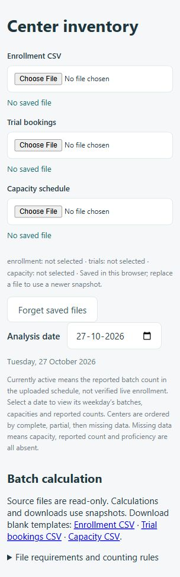

# Trial Limit System

A local dashboard for reviewing enrollment, trial bookings, batch capacity, and occupancy. Upload source snapshots, inspect capacity by center or sport, and calculate whether a selected batch has room for additional trials.

## Quick start

Requires **Python 3.10 or newer**. Run these commands in Windows CMD from the project folder:

```cmd
python -m venv .venv
.venv\Scripts\activate
python -m pip install -r app\requirements.txt
start.cmd
```

Open **http://127.0.0.1:8765/**. Keep the terminal open; press **Ctrl+C** to stop the server.

PowerShell users can run `python app/frontend.py` or `./start.ps1` after installing the requirements. Runtime dependencies are listed in `app/requirements.txt`; spreadsheet or document-generation packages are not required to run the dashboard.

## Dashboard preview

The current upload screen, shown at a narrow browser width before files are selected. No private source data is included in this screenshot.



## Use the dashboard

1. Upload the **Enrollment CSV**, **Trial bookings** CSV or Query result XLSX, and **Capacity schedule** CSV or MAIN XLSX.
2. Choose the **Analysis date**. Inventory views use the batches for that date's weekday.
3. Review the available reports:

   | View | Purpose |
   | --- | --- |
   | Daily report | Review batches by center and sport, capacity, reported counts, and places left. |
   | Over-capacity batches | Find batches whose reported counts exceed capacity. |
   | Weekly center view | Inspect a selected center's weekly schedule and filter by sport. |
   | Sport view | Review sport groupings, including over-capacity sections. |
   | Sports-only summary | Inspect the sport-level summary. |

4. In **Batch calculation**, select a capacity batch and its exact enrollment academy, center, and sport. Review any restored approved mapping. For a restricted proficiency pool, select every exact age/course membership covered by the capacity; **Open** covers all ages/courses.
5. Confirm the source link, then click **Calculate selected batch**. Review occupancy, remaining places, and any unresolved issues before downloading the calculation as CSV.

The **Batch calculation** panel includes blank CSV templates and expandable **File requirements and counting rules**. Templates are separate downloads; original source files are never converted or overwritten.

## Input files

| Source | Supported formats | Important details |
| --- | --- | --- |
| Enrollment | CSV | Exact academy/center/sport, age/course, shared Player DB ID, start/end dates, and slots. Enrollment dates accept `YYYY-MM-DD` and the original export's `DD-MM-YYYY` format. |
| Trial bookings | CSV or Query result XLSX | Scheduled date, time, status, scope, and identity fields. Trial dates use `YYYY-MM-DD`. Shared Player DB ID and Trial Booking ID support reliable deduplication and conflict checks. |
| Capacity schedule | CSV or MAIN XLSX | Sport, center, batch time, weekday, total capacity, city, and proficiency. Reported counts remain snapshot values. |

Slots retain their original weekday/time strings, such as `Monday 6:00 PM - 7:00 PM`. Download the templates for the exact CSV column names.

A fresh clone does not contain local source snapshots or approved mappings. Use your own exports. For configured-file views, place the required sources in `input/` and update `app/config.json`; relative paths resolve from the project folder. The configured historical capacity filename may be absent, so upload current snapshots for the upload workflow. Restore authorized mapping records into `mapped/` when needed.

## How counts work

- Inventory **Currently active** values are reported counts from the uploaded capacity schedule, not verified live enrollment.
- Selected-batch calculations separate enrolled students, booked trial rows, duplicate trials, trials already enrolled, occupancy preview, confirmed occupancy, remaining places, and known excess.
- Shared student IDs deduplicate within a selected session/pool across courses. Separate sessions have separate capacities. Enrollment date boundaries are inclusive; the export's Active field is ignored.
- Cancelled trials are excluded. Conflicting booking IDs, missing identities, malformed records, or unresolved eligibility can prevent confirmed totals and remaining places. Name/mobile fallback remains provisional.
- Reported capacity-file counts are not added to calculated enrollment occupancy. Similarity alone never approves a mapping.

Calculations do not create bookings or save mapping approvals. Editing the target or memberships creates a temporary manual selection; **Restore approved mapping** resets it. Saved mappings are rejected when their capacity definitions or membership targets change.

## Local data and exports

Source snapshots and approval records remain read-only. Approved mappings use `mapped/approved_batch_mappings.json`; source-specific center overrides use `mapped/capacity_center_overrides.json`.

Browser storage remembers uploaded snapshots. Replace a snapshot when its owner provides a newer export, or use **Forget saved files**. Changing files, date, or selected scope clears the previous calculation.

Calculation CSV exports include the analysis date, selected scope, source SHA-256 fingerprints, and review issues. Detailed upload diagnostics are stored outside the dashboard in `reports/`, with a `report.md` summary and `details.json`. Identical inputs and results reuse their report; different inputs, dates, or calculations produce a separate folder.

Local input files, mappings, generated reports, credentials, caches, and virtual environments are excluded by `.gitignore`. Documentation screenshots live in `docs/screenshots/` so they can be committed with this README.

## Project layout

```text
app/          Python application, HTML/JavaScript views, config, requirements
input/        Local enrollment, trial, and capacity snapshots (ignored)
mapped/       Local approved mappings and overrides (ignored)
outputs/      Generated analysis, exports, and audit evidence (ignored)
reports/      Upload diagnostics (ignored)
tests/        Automated Python tests and test runner
tools/        UI checks and verification utilities
tools/archive/ Historical audit and document-generation scripts
docs/         Setup instructions, screenshots, and development history
start.cmd     Windows CMD launcher
start.ps1     PowerShell launcher
```

## Validation

Run the Python test suite:

```cmd
python tests\run_tests.py
```

With Node.js installed, run the relevant UI logic checks:

```cmd
node tools/upload-workflow-check.js
node tools/sport-view-check.js
node tools/sport-overcapacity-check.js
```

The optional real-snapshot check, `python tools/verify_upload_snapshots.py`, requires local source files and existing approved links. It writes `outputs/upload_workflow_verification.json` and does not grant approvals. Historical analysis/export scripts may depend on private snapshots and machine-specific tooling. Scripts in `tools/archive/` retain old assumptions and paths; review them before use, especially approval scripts.

## GitHub

Repository: [eddytiya/trial-limit-system](https://github.com/eddytiya/trial-limit-system).

See [Windows CMD publishing instructions](docs/GITHUB_SETUP.md). After reviewing changes, publish updates with:

```cmd
git add README.md docs/screenshots
git diff --cached --stat
git commit -m "Update README with dashboard screenshot and usage guide"
git push
```

Development history is in [docs/HISTORY.md](docs/HISTORY.md). Historical migration evidence remains in the local `outputs/` directory.
